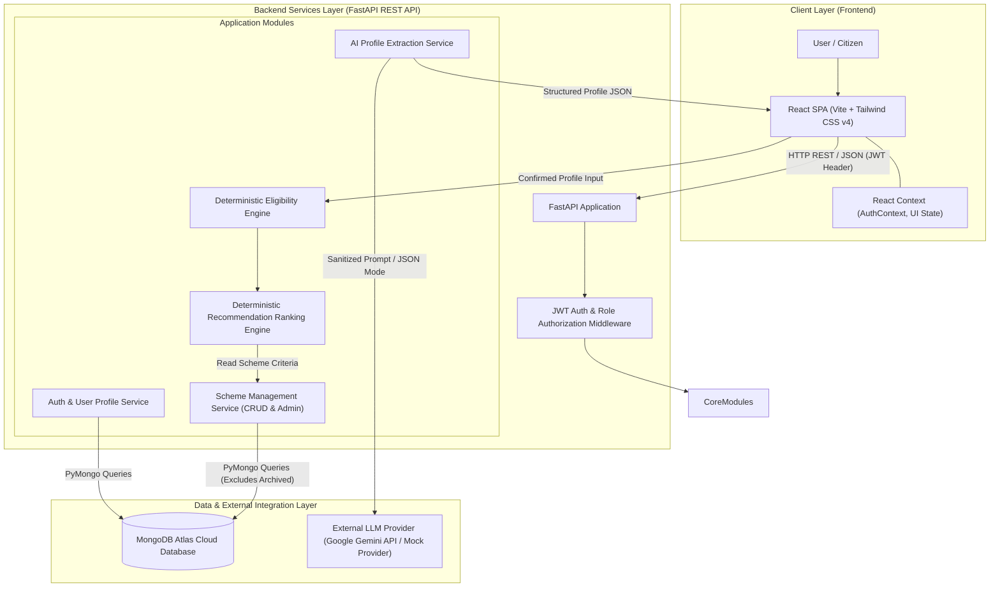
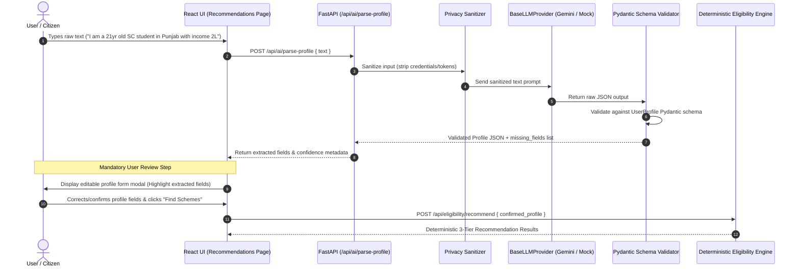
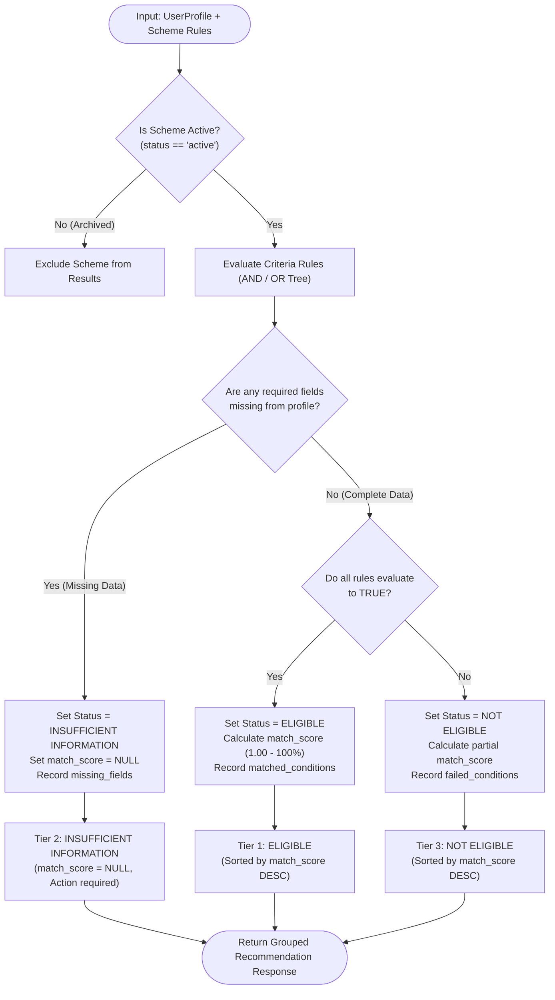
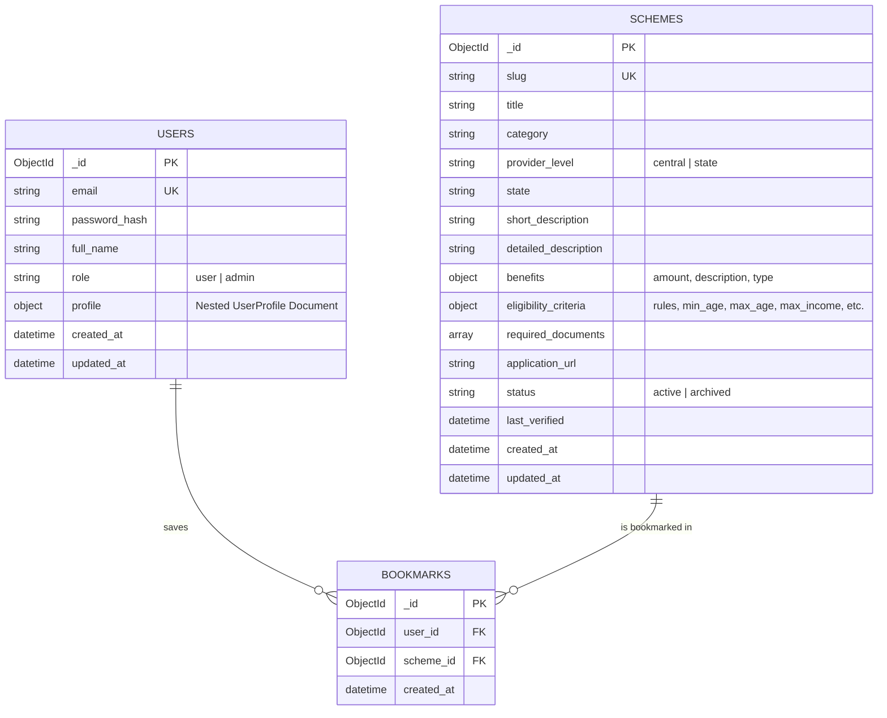

# System Architecture & Technical Specifications

This document presents the structural and procedural architecture of the **Government Scheme Recommendation System**, detailing system components, control flows, data pipelines, and database schemas.

---

## 1. High-Level 3-Tier System Architecture

The application adopts a modular, decoupled 3-tier architecture comprising a modern React Single Page Application (SPA), an asynchronous FastAPI REST backend, a MongoDB Atlas document store, and an isolated external AI abstraction layer.

### Architectural Principles & Boundaries
1. **Decoupled Engine**: The eligibility engine (`EligibilityEngine`) is completely isolated from HTTP controllers and database models, accepting pure Pydantic profile/scheme primitives.
2. **AI Boundary Isolation**: The AI layer (`AIExtractModule`) communicates exclusively with external LLM providers or mock adapters. It converts raw natural-language text into candidate structured user profile fields. It **never** interacts with the eligibility engine directly and **never** makes eligibility decisions.
3. **Admin Access Control**: All administrative endpoints (`POST/PUT/DELETE /api/schemes/*`) are protected by dependency injection (`get_current_admin`), enforcing HTTP 403 Forbidden for non-admin users.

---

## 2. Natural-Language AI Profile Extraction Flow

The natural-language extraction pipeline enforces strict user agency and validation. AI extraction outputs must be reviewed and confirmed by the citizen before any eligibility evaluation occurs.

---

## 3. Deterministic Eligibility & Recommendation Flowchart

The eligibility engine processes user profile attributes against scheme criteria using pure boolean logic and missing-information tracking.

---

## 4. Entity-Relationship (ER) & Data Model Diagram

The persistent data storage is managed in MongoDB Atlas using indexed JSON document models.

### Collection Schemas & Data Constraints

#### 1. `users` Collection
- **`email`**: Unique indexed string (`unique=True`).
- **`password_hash`**: Bcrypt salted hash string (never plain-text).
- **`role`**: Enums: `"user"` (default public registration) or `"admin"`.
- **`profile`**: Sub-document representing candidate demographic fields:
  - `age` (int), `gender` (string), `state` (string), `annual_income` (float), `occupation` (string), `education` (string), `category` (string), `is_student` (bool), `is_farmer` (bool), `is_disabled` (bool).

#### 2. `schemes` Collection
- **`slug`**: Unique indexed string (`unique=True`).
- **`status`**: Enums: `"active"` or `"archived"`. Queries for public endpoints filter strictly by `{ "status": "active" }`.
- **`eligibility_criteria`**: Structured rule definitions evaluated by engine:
  - `min_age`, `max_age`, `max_income`, `allowed_states`, `allowed_occupations`, `allowed_education`, `allowed_categories`, `required_student`, `required_farmer`, `required_disabled`.

#### 3. `bookmarks` Collection
- **Compound Unique Index**: `(user_id, scheme_id)` to prevent duplicate bookmarks.
